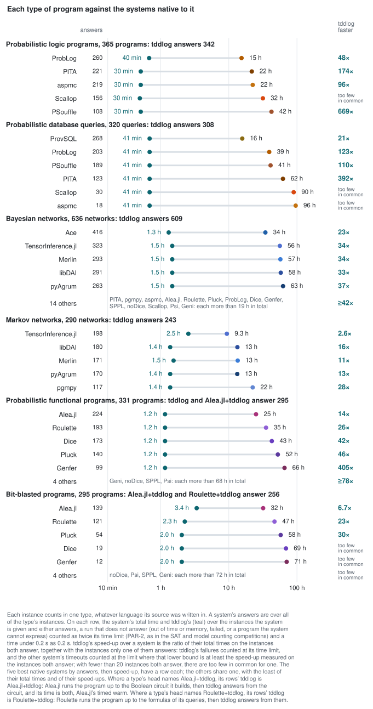

# tddlog

<p align="center">
  
  <br>
  <a href="https://tractables.github.io/tddlog/"></a>
  <a href="https://crates.io/crates/tddlog"></a>
  <a href="https://pypi.org/project/tddlog/"></a>
  <a href="https://github.com/Tractables/tddlog/actions/workflows/ci.yml"></a>
  <a href="https://tractables.github.io/tddlog/api/tddlog/"></a>
  <a href="https://tractables.github.io/tddlog/python/"></a>
  <a href="https://tractables.github.io/tddlog/c/"></a>
</p>

**Exact probabilistic inference by compilation into tree decision diagrams.**

tddlog computes exact probabilities for ProbLog programs, Bayesian and
Markov networks, and Dice programs. It is a command-line tool and a Rust
library, with Python, C and WebAssembly bindings.

<!-- results:headline -->
On [probabilistic logic programs](https://tractables.github.io/tddlog/#/category/logic-programs), tddlog is **214×** faster than ProbLog, and on [Bayesian networks](https://tractables.github.io/tddlog/#/category/bayesian-networks) **55×** faster than Ace, the existing system that answers the most of each. [Detailed results below](#how-well-does-it-work).
<!-- /results:headline -->

**Website: [tractables.github.io/tddlog](https://tractables.github.io/tddlog/).**
It has every result, by program type and by baseline, the [playground],
which runs tddlog in the browser, and the [guide].

## How well does it work?

tddlog was compared with every exact inference system we could find, each
type of program with the systems that natively handle it, and every answer
was checked against an exact reference.

<p align="center">
  <a href="https://tractables.github.io/tddlog/#/types"></a>
  <br>
<!-- results:overview -->
<!-- written from bindings/wasm/results/categories.json, sha256 157bfc8f8f63add3f252def7484ef5feb65433b19a79e953f2b3c75458387303 -->
<sub>As of 2026-11-09. Click the figure for every result.</sub>
<!-- /results:overview -->
</p>

A richer language can keep its own front end and hand its inference to
tddlog. Alea.jl and Roulette do so through tddlog backends
([integrations](https://tractables.github.io/tddlog/#/integrations)),
each against itself alone:

<!-- results:integrations -->
| Integration | Instances | Answers | Total time | Faster |
|---|--:|--:|--:|--:|
| Alea.jl+tddlog against Alea.jl | 1001 | 647 (Alea.jl 379) | 6.5 h (Alea.jl 92 h) | 12× |
| Roulette+tddlog against Roulette | 1269 | 802 (Roulette 509) | 8.6 h (Roulette 90 h) | 9.3× |
<!-- /results:integrations -->

## Install

Nothing to install: the [playground] runs tddlog in the browser.

Prebuilt, on Linux x86-64 (glibc 2.28 or newer):

```sh
curl -L https://github.com/Tractables/tddlog/releases/download/v0.1.1/tddlog-v0.1.1-x86_64-unknown-linux-gnu.tar.gz | tar xz
cd tddlog-v0.1.1-x86_64-unknown-linux-gnu
./tddlog examples/alarm.pl
```

- **Other platforms:** the
  [release](https://github.com/Tractables/tddlog/releases/tag/v0.1.1) has
  archives for Linux ARM64, macOS and Windows.
- **Python:** `pip install tddlog`
- **C and C++:** prebuilt archives on the same release
  ([C README](bindings/c/README.md)).
- **From [crates.io](https://crates.io/crates/tddlog)**, with Rust 1.88 or newer and a C++20 compiler:
  `cargo install --locked tddlog`

The guide's [getting started](https://tractables.github.io/tddlog/guide/#getting-started)
covers each platform and what to do if the build fails.

## Getting started

A program states probabilistic facts, rules, evidence and queries.
This is [examples/alarm.pl](examples/alarm.pl):

```prolog
0.1::burglary.
0.2::earthquake.
0.7::hears_alarm(john).
0.4::hears_alarm(mary).
alarm :- burglary.
alarm :- earthquake.
calls(X) :- alarm, hears_alarm(X).
evidence(calls(john), true).
query(burglary).
query(earthquake).
query(calls(mary)).
```

tddlog prints the probability of each query given the evidence:

```text
$ tddlog alarm.pl
burglary:       0.357143
earthquake:     0.714286
calls(mary):    0.400000
```

Each fact `p::f` holds with probability p, independently of the others.
The rules derive the other atoms.

The [guide] describes the language and the command line. Its worked
examples open in the [playground]. [examples/](examples/) lists every
example program.

## What it reads

- [ProbLog programs](https://tractables.github.io/tddlog/guide/#language),
  with function symbols, lists and `findall`.
- [LPADs](https://tractables.github.io/tddlog/guide/#lpad) written for
  cplint and PITA.
- [Bayesian networks](https://tractables.github.io/tddlog/guide/#network-files)
  in BIF, Hugin, GeNIe or UAI, and Markov networks in UAI.
- [Dice programs](https://tractables.github.io/tddlog/guide/#dice).
- [Circulette netlists](https://tractables.github.io/tddlog/guide/#circulette).
- [Alea.jl](https://tractables.github.io/tddlog/guide/#alea) and
  [Roulette](https://tractables.github.io/tddlog/guide/#roulette) programs,
  through those systems' tddlog backends.

tddlog tells the format from the file. In a checkout of the repository:

```text
$ tddlog examples/car.net --evidence examples/car.inst --query fuel,plugs,starter
$ tddlog tests/dice/arith.dice
$ tddlog --program tests/lpad/coin.cplint.pl
```

Every input is reduced to a probabilistic Datalog program. `--program`
prints it, and `--ground` prints its ground program, which ProbLog also
reads. `--cnf` writes the ground program as a
[weighted CNF](docs/design.md#grounding-srcground). The guide lists
[what tddlog does not read](https://tractables.github.io/tddlog/guide/#not-read).

## How it works

1. tddlog grounds the part of the program that the queries and the
   evidence depend on, and simplifies it.
2. It compiles the ground program bottom up into tree decision diagrams
   (TDDs), with the [tididi](https://github.com/Tractables/tididi) library.
   The layout of the diagrams' variables comes from tree decompositions,
   computed with [goatd](https://github.com/Tractables/goatd).
3. It reads every query's probability off the diagrams in one pass.

[How it works](https://tractables.github.io/tddlog/#/how) on the website
walks through example programs, stage by stage, and
[Why it is fast](https://tractables.github.io/tddlog/#/why) shows the
optimizations, each with an example.
[docs/design.md](docs/design.md) describes each stage and the cases
measured behind it.

## Using it from Rust, Python and C

- **Rust:** add `tddlog = "0.1"`
  under `[dependencies]`. [`tddlog::solve`] answers a program
  ([Rust API]).
- **Python:** `tddlog.solve(text)` ([Python README](bindings/python/README.md)).
- **C and C++:** `tddlog_solve` ([C README](bindings/c/README.md)).
- **WebAssembly:** the module behind the playground
  ([WebAssembly README](bindings/wasm/README.md)).

The guide shows [one example in each](https://tractables.github.io/tddlog/guide/#library).

## Building and testing

From a checkout, `cargo build --release` builds `target/release/tddlog`.
`cargo test --profile quick` checks it against ProbLog's answers, as CI
does. [CONTRIBUTING.md](.github/CONTRIBUTING.md) lists the checks a change
runs.

## Citing

tddlog has no paper yet: cite the software, as [CITATION.cff](CITATION.cff)
describes it (GitHub's "Cite this repository"). TDDs were introduced in
[*A Canonical Generalization of OBDD*](https://arxiv.org/abs/2604.05537).

## Acknowledgements

This material is based upon work supported by the Defense Advanced Research
Projects Agency (DARPA) under Agreement No. HR0011269E224.

## License

Apache-2.0 ([LICENSE](LICENSE)). The copies of third-party programs in
`tests/problog` and `tests/dice` keep their own licenses
([NOTICE](NOTICE)); [THIRD-PARTY.md](THIRD-PARTY.md) lists the components
compiled into the binaries.

[guide]: https://tractables.github.io/tddlog/guide/
[playground]: https://tractables.github.io/tddlog/playground/
[Rust API]: https://tractables.github.io/tddlog/api/tddlog/
[`tddlog::solve`]: https://tractables.github.io/tddlog/api/tddlog/fn.solve.html
