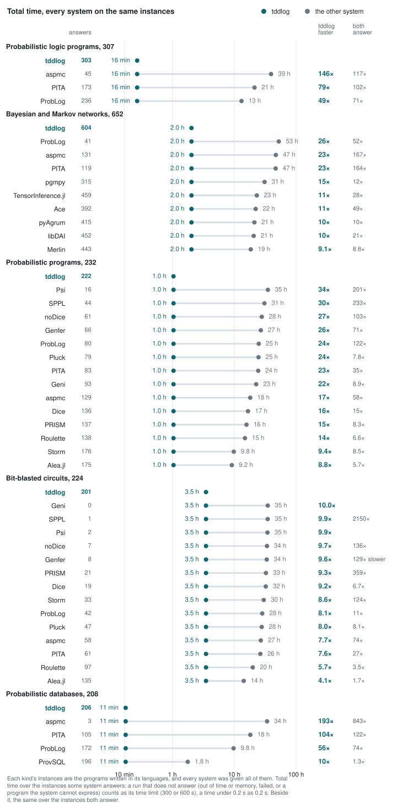
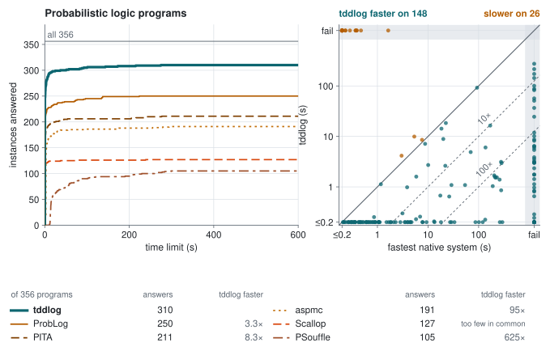
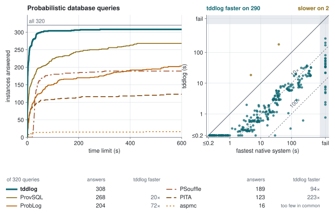
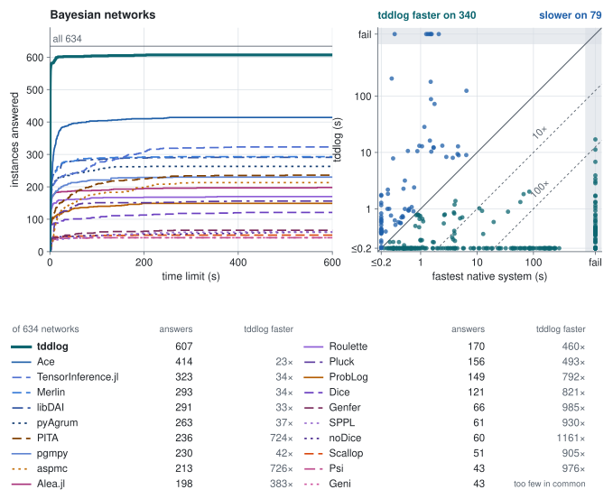
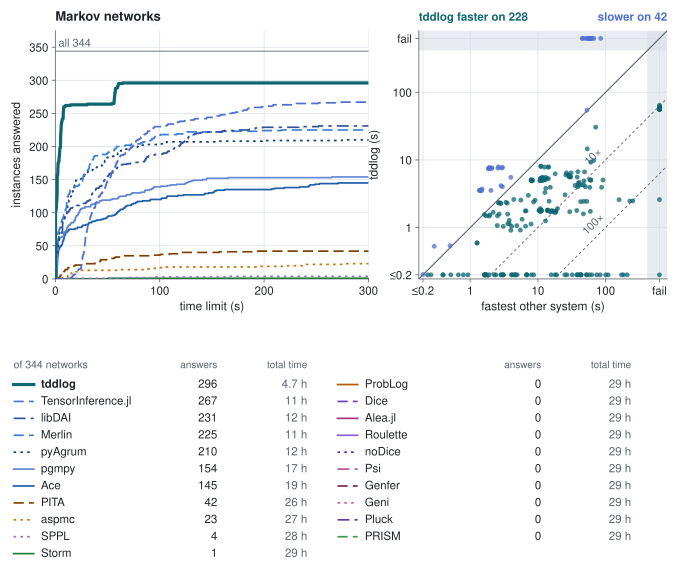
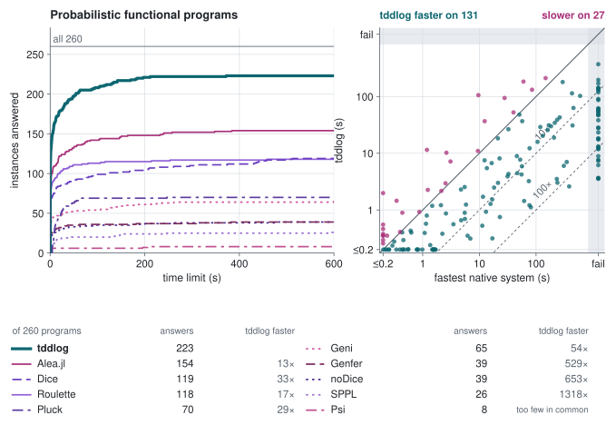
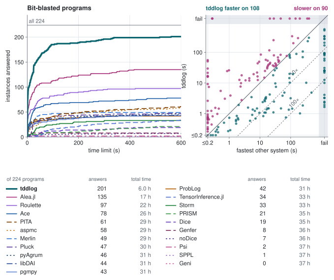
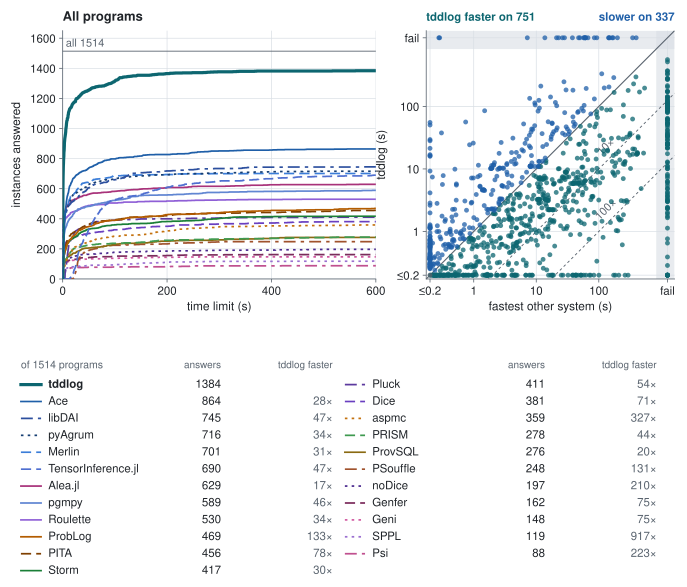

# tddlog

<p align="center">
  
  <br>
  <a href="https://github.com/Tractables/tddlog/actions/workflows/ci.yml"></a>
  <a href="https://tractables.github.io/tddlog/"></a>
  <a href="https://tractables.github.io/tddlog/guide/"></a>
  <a href="https://tractables.github.io/tddlog/api/tddlog/"></a>
  <a href="https://tractables.github.io/tddlog/python/"></a>
  <a href="https://tractables.github.io/tddlog/c/"></a>
  <a href="https://tractables.github.io/tddlog/results/"></a>
</p>

**Exact probabilistic inference by compilation into tree decision diagrams.**

tddlog is an exact inference engine for probabilistic Datalog:
probabilistic facts and annotated disjunctions, and recursive rules with
negation, comparisons and arithmetic, over atoms whose arguments are
constants. Front ends reduce richer inputs to this intermediate
language: ProbLog programs with function symbols and lists, Bayesian
and Markov networks, Dice programs and LPADs. The
engine grounds the program, simplifies it, compiles it bottom up into
tree decision diagrams (TDDs) with the
[tididi](https://github.com/Tractables/tididi) library, and reads every
query's probability off the diagrams. It is a Rust library and
command-line tool, with Python, C and WebAssembly bindings, and it
[runs in the browser](https://tractables.github.io/tddlog/).

- [Front ends](#front-ends): the languages and formats tddlog reads, and
  how each reduces to probabilistic Datalog.
- [Inside the engine](#inside-the-engine): the techniques the inference
  rests on.
- [Performance](#performance): tddlog against every exact inference
  system we could find, each type of program against the systems
  native to it.

<p align="center">
  
</p>

## Install

- **Command line:** `cargo install --locked --git https://github.com/Tractables/tddlog tddlog`.
- **Rust:** `tddlog = { git = "https://github.com/Tractables/tddlog" }` under
  `[dependencies]`. See the [Rust API].
- **Python:** build the package from a checkout. See the
  [Python README](bindings/python/README.md).
- **C and C++:** build the CMake package from a checkout. See the
  [C README](bindings/c/README.md).
- **Browser:** the [playground] runs tddlog in the tab, with nothing to install.

A build from source needs Rust 1.88 or newer and a C++ compiler (gcc 12
or newer, or a recent clang) for the tree-decomposition solver that goatd
vendors.

## Getting started

A program states probabilistic facts, rules, evidence and queries.
This is `examples/alarm.pl`:

```prolog
0.1::burglary.
0.2::earthquake.
0.7::hears_alarm(john).
0.4::hears_alarm(mary).
alarm :- burglary.
alarm :- earthquake.
calls(X) :- alarm, hears_alarm(X).
evidence(calls(john), true).
query(burglary).
query(earthquake).
query(calls(mary)).
```

tddlog prints the probability of each query given the evidence:

```text
$ tddlog examples/alarm.pl
burglary:       0.357143
earthquake:     0.714286
calls(mary):    0.400000
```

Each probabilistic fact `p::f` holds with probability p, independently
of the others, and the rules derive the other atoms. The alarm goes off
with probability 1 − 0.9 × 0.8 = 0.28, so John calls with probability
0.28 × 0.7 = 0.196, and P(burglary | John calls) = 0.1 × 0.7 / 0.196 =
0.357143.

The [guide] describes the language and the command line, with worked
examples that open in the [playground]: the [reachability example]
queries paths in a graph with cycles, the [negation example] the winning
positions of a game defined by negation through recursion, the
[Bayesian network example] a network's marginals, and the
[binary integers example] the sum of two random integers.
[examples/](examples/) lists every example program by what it shows.

## Front ends

Every input is reduced to a probabilistic Datalog program before
inference. `tddlog --ground` prints the ground program that results,
which ProbLog also reads, so each reduction can be checked on its own.

| Input | Read by | Reduced to probabilistic Datalog as |
|---|---|---|
| ProbLog programs | tddlog | function symbols and lists ground to constants, with ProbLog's list predicates and `findall/3` over deterministic goals |
| Bayesian networks in BIF, Hugin, GeNIe or UAI, with evidence in Ace's `.inst` or UAI's `.evid` | tddlog, by the file's extension | one annotated disjunction per row of each table |
| Markov networks in UAI | tddlog | one observed atom per factor; `--evidence-probability` prints the partition function |
| Dice programs | tddlog, by the extension `.dice` | each integer as its bits, each operation as rules over them, a loop as recursion over a step index |
| Alea.jl programs (`model()` and `QUERY`) | [`scripts/alea2problog.jl`](scripts/alea2problog.jl), in Julia with Alea.jl | the Boolean circuit Alea.jl builds: each flip a probabilistic fact, each gate a rule, each observation evidence |
| LPADs written for cplint and PITA | tddlog, where the file holds `:- begin_lpad.` | the same clauses in ProbLog's syntax, with the database clauses they call and the file's example queries |

```text
$ tddlog examples/asia.net --query leaves
$ tddlog tests/dice/arith.dice
```

`tddlog --program examples/asia.net` prints the program a network is
read as, `tddlog --program tests/dice/arith.dice` a Dice program's, and
`tddlog --program tests/lpad/coin.cplint.pl` an LPAD's. As a library, [`tddlog::solve`] takes a program's text and the
command line's options and returns the answers, and [`tddlog::read`]
reads an input in any of these formats, a network with its evidence
file, as that program. The
[Python](bindings/python/README.md) (`tddlog.solve(text, format="dice").answers`),
[C](bindings/c/README.md) and [WebAssembly](bindings/wasm/README.md)
bindings take the text with its format's name and call both; a front
end of one's own writes the text, as
[examples/sprinkler.rs](examples/sprinkler.rs) does from Rust data.

Not yet read: cut, if-then-else, `call/N`, `assert`, strings and
probabilities computed in a rule's body in ProbLog, and `findall/3` over
a probabilistic or recursive goal; lists, `/`, `%`, `nth_bit` and
`sample` in Dice.

## Inside the engine

The engine answers a ground program exactly, in four stages.
[docs/design.md](docs/design.md) describes each technique and the cases
measured behind it.

**Grounding and simplification**

- **Relevant grounding.** Magic sets and semi-naive bottom-up evaluation
  ground only what the queries and evidence depend on (Fierens et al.,
  TPLP 2015). Transitive closures ground from their bound end, and
  linear recursion is solved without iteration by Gaussian elimination
  (Tarjan, 1981).
- **And-inverter graph.** Acyclic rules are hashed into an and-inverter
  graph, so a gate the program writes many times is built once: of a
  12-bit circuit's 6 635 gates, 4 941 merge. Gates equal to another
  gate, to its negation or to a constant are then found by random
  simulation, proved by SAT and merged (fraiging, Mishchenko et al.,
  2005).
- **Conditioning on the evidence.** Unit propagation, SAT backbones and
  equivalences fix and merge facts, and tables are renormalized to the
  evidence, before anything is compiled.
- **Table structure.** The rows of one distribution share a class atom,
  rows that exclude each other share switches, and a choice read under
  exclusive contexts becomes one fact per context.

**Compilation**

- **Tp-compilation.** Each derived atom's TDD is built bottom up by the
  immediate-consequence operator on diagrams (Vlasselaer et al., IJCAI
  2015), one strongly connected component at a time and each shared atom
  once. Negation through recursion takes the well-founded fixpoint by
  approximation fixpoint theory (Bogaerts and Van den Broeck, ICLP 2015),
  which answers sound programs that ProbLog rejects.
- **Names where depth needs them.** An atom read across a narrow cut of
  the variable order is read through a named copy tied to its definition,
  as in a Tseitin encoding. After the compile, each name is kept or
  composed away, whichever gives the smaller diagram.
- **Projected scopes.** Each component compiles over the part of the
  vtree its facts lie in, since a TDD has a node on every level of its
  vtree.

**Vtrees**

- **Layouts from the program.** A vtree, the layout of the diagrams'
  variables, is read from tree decompositions computed with
  [goatd](https://github.com/Tractables/goatd), from the rules'
  dependency order, from the order the program states its facts in, or
  from the fan-in order of its rules.
- **Decision vtrees for circuits.** In a bit-blasted program, an atom
  read under a fact is read conditioned on it, a decision list becomes a
  balanced tree, and these guards give the vtree.
- **Layouts as trials.** By default, several layouts run in turns under
  doubling budgets of engine work, one of them a vtree searched by
  rotations during the compile, and the first to finish answers. The
  budgets count pairs and units of engine work, not seconds, so the same
  layout wins on every machine.

**Queries and evidence**

- **Every marginal in one pass.** The evidence is conjoined bottom up
  along the vtree, and every query is read off one backward pass.
  Probabilities below a double's range, as a thousand observations give,
  keep an exponent of their own instead of underflowing.
- **Summing out.** Where only the probability of the evidence or a
  partition function is asked, each join sums out what no later join
  reads.

## Performance

tddlog was run against every exact inference system we could find. The
results are partitioned by type of program, in six types, and each
instance counts in one type, whatever language its source was written
in. Each type is compared with the systems that natively handle it:
ProbLog, PITA, aspmc and PSouffle on logic programs; ProvSQL and the
same four on database queries; Ace, Merlin, pyAgrum, pgmpy, libDAI and
TensorInference.jl on Bayesian and Markov networks, and on Bayesian
networks also the logic programming systems and the probabilistic
programming languages; Dice, Alea.jl, Roulette, noDice, Psi, Genfer,
SPPL, Geni and Pluck on functional and bit-blasted programs. A system is
given each instance of a type it can take, through a translation where
it cannot read the original (an LPAD for ProbLog, a Dice program for
Roulette). All programs, the union of the six, has every system on
every program it is given, Storm and PRISM included. Each run is
single-threaded, each suite with its own time limit (300 to 1200
seconds), and every answer is checked against an exact reference.

A system's answers count over all of a type's instances. Its total time
and tddlog's are over the instances the system is given and either
answers, a run that does not answer counted as twice its time limit
(PAR-2, as in the SAT and model counting competitions) and a time under
0.2 s as 0.2 s; an instance that neither answers adds nothing.
tddlog's speed-up over a system is the ratio of their total times on
the instances both answer, together with the instances only one of them
answers: tddlog's failures counted at its time limit, and the other
system's timeouts counted at the limit where that lower bound is at
least the speed-up measured on the instances both answer. The instances
both answer in under 0.2 s are left out of it, and with fewer than 20
instances both answer there are too few in common for a speed-up. A
system run in several forms (ProbLog's three compilers, Ace's two
modes) counts as its fastest form on each instance. The figure above
has a row for each of a type's five best native systems, by answers and
then speed-up, and puts the others in one row with the least of their
total times and of their speed-ups. The cactus plots count the
instances each system answers within each time limit, for tddlog and
the native systems given at least 20 of the type's instances, and the
scatter plots put tddlog's time against the fastest of those systems,
instance by instance.
The [results page](https://tractables.github.io/tddlog/results/) has
every instance and time, each type with its native systems and all
programs with every system, a page for each system (its version and
settings, how it was given each program, its plots against tddlog on
the programs in its own language and on those translated for it, and
its paper), and for each benchmark the program as its authors wrote it,
as each system was given it, and every run;
[docs/baselines.md](https://github.com/Tractables/tddlog/blob/baselines/docs/baselines.md)
says how each system was given each suite and what it was not given.

### Probabilistic logic programs

<p align="center">
  
</p>

ProbLog programs of 13 families: paths in random graphs and in grids,
Biomine's paths, smokers, UW-CSE, Cora's citation matching, blood types,
pedigrees, sickness, Mastermind, MNIST addition, Prob-EC's event
calculus and taint analyses of Android apps.

tddlog answers **120 of 129**. Against each native system: its answers,
its total time and tddlog's over the programs it is given and either
answers, and tddlog's speed-up:

| System | Answers | Its total time | tddlog's total time | tddlog faster |
|---|--:|--:|--:|--:|
| PITA | 63 | 11 h | 24 min | 59× |
| ProbLog | 58 | 12 h | 24 min | 126× |
| PSouffle | 54 | 13 h | 24 min | 145× |
| aspmc | 31 | 16 h | 24 min | 537× |

- On Biomine, ProbLog's own benchmark, tddlog answers all 10 queries and
  ProbLog 4.

### Probabilistic database queries

<p align="center">
  
</p>

Boolean queries over tuple-independent databases: 16 TPC-H queries,
the queries h0 and h1, the safe queries QW and Q9, and paths of two
edges in random graphs.

tddlog answers **308 of 320**. Against each native system: its answers,
its total time and tddlog's over the queries it is given and either
answers, and tddlog's speed-up:

| System | Answers | Its total time | tddlog's total time | tddlog faster |
|---|--:|--:|--:|--:|
| ProvSQL | 284 | 6.9 h | 45 min | 4.9× |
| ProbLog | 204 | 39 h | 45 min | 72× |
| PSouffle | 189 | 40 h | 45 min | 48× |
| PITA | 123 | 62 h | 45 min | 223× |
| aspmc | 16 | 97 h | 45 min | too few in common |

- Where others win: ProvSQL is fast on the easy TPC-H queries, its own
  benchmarks, and faster than tddlog on 107 of them.

### Bayesian networks

<p align="center">
  
</p>

bnlearn's networks, the large ones and the Roulette and noDice papers'
versions among them, Ace's networks, the noisy-or networks, and the
UAI 2022 networks whose factors are conditional probability tables:
Promedus diagnosis, pedigree, or_chain and BN networks, and the
blockmap, Mastermind and fs networks that Ace's benchmarks also have.

tddlog answers **291 of 292**. Against each native system: its answers,
its total time and tddlog's over the networks it is given and either
answers, and tddlog's speed-up:

| System | Answers | Its total time | tddlog's total time | tddlog faster |
|---|--:|--:|--:|--:|
| Ace | 272 | 4.1 h | 2 min | 85× |
| Alea.jl | 198 | 19 h | 2 min | 433× |
| Merlin | 186 | 21 h | 2 min | 443× |
| libDAI | 179 | 22 h | 2 min | 476× |
| TensorInference.jl | 178 | 27 h | 2 min | 605× |
| 13 others: Roulette, pyAgrum, Pluck, aspmc, PITA, pgmpy, Dice, ProbLog, Genfer, SPPL, noDice, Psi, Geni | 43 to 168 | over 24 h each | 2 min | at least 490× |

PSouffle was given 10 of the networks and answers 6.

### Markov networks

<p align="center">
  
</p>

The other UAI 2022 networks, whose factors are not conditional
probability tables over an acyclic graph: object detection,
segmentation, grid, DBN, CSP and Alchemy networks, protein side chains,
the rus networks and weighted CSPs.

tddlog answers **215 of 263**. Against each native system: its answers,
its total time and tddlog's over the networks it is given and either
answers, and tddlog's speed-up:

| System | Answers | Its total time | tddlog's total time | tddlog faster |
|---|--:|--:|--:|--:|
| TensorInference.jl | 187 | 9.9 h | 3.1 h | 2.6× |
| libDAI | 175 | 9.5 h | 38 min | 19× |
| Merlin | 167 | 9.5 h | 48 min | 10× |
| pyAgrum | 166 | 9.3 h | 38 min | 14× |
| pgmpy | 109 | 19 h | 38 min | 40× |
| Ace | 74 | 25 h | 38 min | 68× |

- Where others win: 15 partition functions of the UAI 2022 final set, 14
  of them protein networks, run out of time or memory.
  TensorInference.jl answers each in 45 to 85 s.

### Probabilistic functional programs

<p align="center">
  
</p>

Programs over discrete values with conditionals and loops, of 16
families: the Caesar cipher, diamond and ladder networks, Geni's router
grids with failing links or routers and its weather factory, hidden
Markov models and Pluck's sequence models, a Markov chain, a lossy
network, contract signing, a perturbed-memory interpreter, Cao et al.'s
integer programs, the coupon collector, 3-SAT and the Dice paper's small
programs.

tddlog answers **222 of 258**. Against each native system: its answers,
its total time and tddlog's over the programs it is given and either
answers, and tddlog's speed-up:

| System | Answers | Its total time | tddlog's total time | tddlog faster |
|---|--:|--:|--:|--:|
| Alea.jl | 154 | 24 h | 1.1 h | 13× |
| Dice | 119 | 36 h | 1.1 h | 33× |
| Roulette | 118 | 35 h | 1.1 h | 16× |
| Geni | 65 | 53 h | 1.1 h | 54× |
| Pluck | 63 | 53 h | 1.1 h | 47× |
| 4 others: Genfer, noDice, SPPL, Psi | 8 to 39 | over 61 h each | 1.1 h | at least 556× |

### Bit-blasted programs

<p align="center">
  
</p>

Programs over integers written in Alea.jl, which compiles each to a
Boolean circuit. Alea.jl runs its own program; every other system is
given the circuit.

tddlog answers **218 of 250**. Against each native system: its answers,
its total time and tddlog's over the programs it is given and either
answers, and tddlog's speed-up:

| System | Answers | Its total time | tddlog's total time | tddlog faster |
|---|--:|--:|--:|--:|
| Alea.jl | 137 | 31 h | 4.9 h | 4.9× |
| Roulette | 98 | 41 h | 2.5 h | 14× |
| Pluck | 47 | 58 h | 2.5 h | 32× |
| Dice | 19 | 67 h | 2.5 h | too few in common |
| Genfer | 12 | 69 h | 2.5 h | too few in common |
| 4 others: noDice, Psi, SPPL, Geni | 0 to 7 | over 70 h each | 2.5 h to 3.2 h | too few in common |

- Where others win: Alea.jl on 65 circuits, six of which tddlog does not
  answer, and Roulette on 34; Genfer on the population models, which it
  answers in milliseconds; Psi on two linear regressions it solves
  symbolically.

### All programs

<p align="center">
  
</p>

The six types together, every system on every program it is given,
natively or through a translation: how the systems fare when the
programs are translated into their languages.

tddlog answers **1374 of 1512**. Against each system: its answers,
its total time and tddlog's over the programs it is given and either
answers, and tddlog's speed-up:

| System | Answers | Its total time | tddlog's total time | tddlog faster |
|---|--:|--:|--:|--:|
| Ace | 863 | 141 h | 6.1 h | 29× |
| libDAI | 745 | 182 h | 5.6 h | 55× |
| pyAgrum | 716 | 186 h | 6.3 h | 38× |
| Merlin | 701 | 192 h | 6.1 h | 36× |
| TensorInference.jl | 690 | 215 h | 8.0 h | 38× |
| 17 others: Alea.jl, pgmpy, Roulette, ProbLog, PITA, Storm, Pluck, Dice, aspmc, ProvSQL, PRISM, PSouffle, noDice, Genfer, Geni, SPPL, Psi | 88 to 629 | over 7.0 h each | 45 min to 7.8 h | at least 5.0× |

- Where others win: pgmpy answers grid25, a logic program's path query
  across a 25 by 25 grid of probabilistic edges, in 144 s on the
  program's ground network, and tddlog runs out of time. PRISM and Storm
  answer Geni's three largest router networks, which tddlog does not, by
  value iteration over decision diagrams in double precision; their
  exact engines time out from 18 to 20 routers. Ace, pyAgrum and pgmpy
  answer two clinical trial circuits that tddlog does not, and Merlin
  one of them.

### Each system on its own benchmarks

Each system on the benchmarks of its own papers, repository or
distribution: its answers and tddlog's, each with its total time over
the instances either answers, and tddlog's speed-up:

| System | Its benchmarks | Instances | The system | tddlog | tddlog faster |
|---|---|--:|--:|--:|--:|
| Ace | Ace's own benchmarks (Chavira and Darwiche) | 46 | 46 in 8 min | 46 in 18 s | 28× |
| ProbLog | The Biomine network of ProbLog's first paper (De Raedt et al., IJCAI 2007) | 10 | 4 in 2.0 h | 10 in 3 min | too few in common |
| PITA | cplint's blood type example, which PITA ships | 1 | 1 in 0.5 s | 1 in 0.2 s | too few in common |
| ProvSQL | The TPC-H queries, ProvSQL's own evaluation | 295 | 275 in 5.2 h | 289 in 38 min | 4.5× |
| Dice | The Dice paper's programs and networks (OOPSLA 2020) and its repository's loops | 69 | 39 in 9.6 h | 67 in 21 min | 27× |
| Alea.jl | The bit-blasting paper's programs (PLDI 2024), Alea.jl's own | 250 | 137 in 31 h | 218 in 4.9 h | 4.9× |
| Alea.jl | Cao et al.'s integer programs (UAI 2023), on Alea.jl's arithmetic branch | 28 | 25 in 3 min | 25 in 5 min | too few in common |
| Roulette | The Roulette paper's programs and networks (PLDI 2025), from its artifact | 114 | 44 in 17 h | 95 in 20 min | 85× |
| Geni | The programs of Geni's evaluation (ICFP 2025) | 60 | 39 in 4.0 h | 49 in 17 min | 13× |
| noDice | noDice's programs (OOPSLA 2026) | 14 | 10 in 1.3 h | 13 in 1 min | too few in common |
| Pluck | Pluck's four sequence models (PLDI 2025) | 4 | 1 in 1.0 h | 4 in 2 min | too few in common |
| Genfer | Genfer's population model (NeurIPS 2023) | 12 | 12 in 4.3 s | 12 in 7 min | too few in common |
| Genfer | The Dice programs Genfer's repository ships | 7 | 7 in 1.4 s | 7 in 1.4 s | too few in common |
| Psi | Psi's R2 linear regression, as Psi's own program | 8 | 2 in 2.0 h | 6 in 47 min | too few in common |
| SPPL | SPPL's hierarchical Markov switching model (PLDI 2021) | 8 | 0 in 2.7 h | 8 in 6 min | too few in common |
| PSouffle | The Android taint analyses of PSouffle's evaluation (FMCAD 2026) | 15 | 10 in 30 min | 12 in 32 s | too few in common |

### Setup

The release run compared tddlog with ProbLog 2.3.0, PITA, aspmc, Ace
3.0, Merlin 1.7.0, pyAgrum 3.2.1, pgmpy 1.1.2, libDAI 0.3.2,
TensorInference.jl 0.6.3, ProvSQL 1.13.0, Dice, Alea.jl, Roulette and
the further systems, on lab and cloud machines. A suite's systems ran in
the same job, side by side in parallel lanes, so times compare within a
suite, and each comparison pairs a baseline with tddlog run on the same
machine in the same lanes. tddlog's rows come from a rerun of its current version on the
same machines, with the same memory per run; the suites that had run on
cloud machines were rerun in full on lab machines, every system side by
side. Dice's loops are given to ProbLog, PITA and aspmc both unrolled and
as recursion, and each is scored on the form it does better on. The
references are ProbLog, Ace, Merlin and Alea.jl where they
answer, Ganak's exact model count, and exact solvers written for this
repository. [docs/benchmarks.md](https://github.com/Tractables/tddlog/blob/baselines/docs/benchmarks.md) on the `baselines` branch has the machines,
versions and every table; the
[`baselines` branch](https://github.com/Tractables/tddlog/tree/baselines)
has the code that runs each system and the copies of their programs.

## Building and testing

From a checkout, `cargo build --release` builds `target/release/tddlog`,
and `cargo test` checks it against ProbLog's answers on the examples and
on ProbLog's own system tests. [CONTRIBUTING.md](.github/CONTRIBUTING.md) lists
the checks a change runs.

## Citing

tddlog has no paper yet: cite the software, as [CITATION.cff](CITATION.cff)
describes it (GitHub's "Cite this repository"). TDDs were introduced in
[*A Canonical Generalization of OBDD*](https://arxiv.org/abs/2604.05537).

## Acknowledgements

This material is based upon work supported by the Defense Advanced Research
Projects Agency (DARPA) under Agreement No. HR0011269E224.

## License

Apache-2.0 ([LICENSE](LICENSE)). The copies of third-party programs in
`tests/problog` and `tests/dice` keep their own licenses
([NOTICE](NOTICE)); [THIRD-PARTY.md](THIRD-PARTY.md) lists the components
compiled into the binaries.

[guide]: https://tractables.github.io/tddlog/guide/
[playground]: https://tractables.github.io/tddlog/
[Rust API]: https://tractables.github.io/tddlog/api/tddlog/
[reachability example]: https://tractables.github.io/tddlog/guide/#reachability
[negation example]: https://tractables.github.io/tddlog/guide/#negation
[Bayesian network example]: https://tractables.github.io/tddlog/guide/#bayesian-network
[binary integers example]: https://tractables.github.io/tddlog/guide/#binary-integers
[`tddlog::solve`]: https://tractables.github.io/tddlog/api/tddlog/fn.solve.html
[`tddlog::read`]: https://tractables.github.io/tddlog/api/tddlog/fn.read.html
