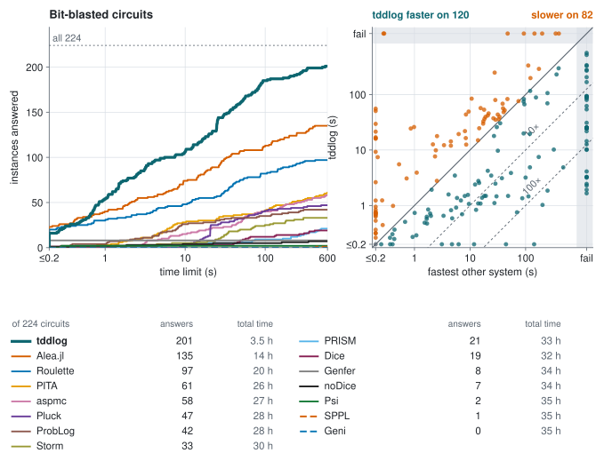

# tddlog

<p align="center">
  
  <br>
  <a href="https://github.com/Tractables/tddlog/actions/workflows/ci.yml"></a>
  <a href="https://tractables.github.io/tddlog/"></a>
  <a href="https://tractables.github.io/tddlog/guide/"></a>
  <a href="https://tractables.github.io/tddlog/api/tddlog/"></a>
  <a href="https://tractables.github.io/tddlog/python/"></a>
  <a href="https://tractables.github.io/tddlog/c/"></a>
  <a href="https://tractables.github.io/tddlog/results/"></a>
</p>

**Exact probabilistic inference by compilation into tree decision diagrams.**

tddlog is an exact inference engine for probabilistic Datalog:
probabilistic facts and annotated disjunctions, and recursive rules with
negation, comparisons and arithmetic, over atoms whose arguments are
constants. Front ends reduce richer inputs to this intermediate
language: ProbLog programs with function symbols and lists, Bayesian
and Markov networks, Dice programs and LPADs. The
engine grounds the program, simplifies it, compiles it bottom up into
tree decision diagrams (TDDs) with the
[tididi](https://github.com/Tractables/tididi) library, and reads every
query's probability off the diagrams. It is a Rust library and
command-line tool, with Python, C and WebAssembly bindings, and it
[runs in the browser](https://tractables.github.io/tddlog/).

- [Front ends](#front-ends): the languages and formats tddlog reads, and
  how each reduces to probabilistic Datalog.
- [Inside the engine](#inside-the-engine): the techniques the inference
  rests on.
- [Performance](#performance): tddlog against every exact inference
  system we could find, by type of program.

<p align="center">
  
</p>

## Install

- **Command line:** `cargo install --locked --git https://github.com/Tractables/tddlog tddlog`.
- **Rust:** `tddlog = { git = "https://github.com/Tractables/tddlog" }` under
  `[dependencies]`. See the [Rust API].
- **Python:** build the package from a checkout. See the
  [Python README](bindings/python/README.md).
- **C and C++:** build the CMake package from a checkout. See the
  [C README](bindings/c/README.md).
- **Browser:** the [playground] runs tddlog in the tab, with nothing to install.

A build from source needs Rust 1.88 or newer and a C++ compiler (gcc 12
or newer, or a recent clang) for the tree-decomposition solver that goatd
vendors.

## Getting started

A program states probabilistic facts, rules, evidence and queries.
This is `examples/alarm.pl`:

```prolog
0.1::burglary.
0.2::earthquake.
0.7::hears_alarm(john).
0.4::hears_alarm(mary).
alarm :- burglary.
alarm :- earthquake.
calls(X) :- alarm, hears_alarm(X).
evidence(calls(john), true).
query(burglary).
query(earthquake).
query(calls(mary)).
```

tddlog prints the probability of each query given the evidence:

```text
$ tddlog examples/alarm.pl
burglary:       0.357143
earthquake:     0.714286
calls(mary):    0.400000
```

Each probabilistic fact `p::f` holds with probability p, independently
of the others, and the rules derive the other atoms. The alarm goes off
with probability 1 − 0.9 × 0.8 = 0.28, so John calls with probability
0.28 × 0.7 = 0.196, and P(burglary | John calls) = 0.1 × 0.7 / 0.196 =
0.357143.

The [guide] describes the language and the command line, with worked
examples that open in the [playground]: the [reachability example]
queries paths in a graph with cycles, the [negation example] the winning
positions of a game defined by negation through recursion, the
[Bayesian network example] a network's marginals, and the
[binary integers example] the sum of two random integers.
[examples/](examples/) lists every example program by what it shows.

## Front ends

Every input is reduced to a probabilistic Datalog program before
inference. `tddlog --ground` prints the ground program that results,
which ProbLog also reads, so each reduction can be checked on its own.

| Input | Read by | Reduced to probabilistic Datalog as |
|---|---|---|
| ProbLog programs | tddlog | function symbols and lists ground to constants, with ProbLog's list predicates and `findall/3` over deterministic goals |
| Bayesian networks in BIF, Hugin, GeNIe or UAI, with evidence in Ace's `.inst` or UAI's `.evid` | tddlog, by the file's extension | one annotated disjunction per row of each table |
| Markov networks in UAI | tddlog | one observed atom per factor; `--evidence-probability` prints the partition function |
| Dice programs | [`scripts/dice2problog.py`](scripts/dice2problog.py) | each integer as its bits, each operation as rules over them |
| LPADs written for cplint and PITA | [`scripts/lpad2problog.py`](scripts/lpad2problog.py) | the same clauses in ProbLog's syntax |

```text
$ tddlog examples/asia.net --query leaves
$ python3 scripts/dice2problog.py tests/dice/arith.dice > arith.pl && tddlog arith.pl
```

`tddlog --program examples/asia.net` prints the program a network is
read as. As a library, [`tddlog::solve`] takes a program's text and the
command line's options and returns the answers, and the
[Python](bindings/python/README.md) (`tddlog.solve(program).answers`),
[C](bindings/c/README.md) and [WebAssembly](bindings/wasm/README.md)
bindings wrap the same call; a front end of one's own writes the text,
as [examples/sprinkler.rs](examples/sprinkler.rs) does from Rust data.

Not yet read: cut, if-then-else, `call/N`, `assert`, strings and
probabilities computed in a rule's body in ProbLog, and `findall/3` over
a probabilistic or recursive goal; lists, `/`, `%`, `nth_bit` and
`sample` in Dice; network files through the bindings, which take a
program's text (`tddlog --program` writes it).

## Inside the engine

The engine answers a ground program exactly, in four stages.
[docs/design.md](docs/design.md) describes each technique and the cases
measured behind it.

**Grounding and simplification**

- **Relevant grounding.** Magic sets and semi-naive bottom-up evaluation
  ground only what the queries and evidence depend on (Fierens et al.,
  TPLP 2015). Transitive closures ground from their bound end, and
  linear recursion is solved without iteration by Gaussian elimination
  (Tarjan, 1981).
- **And-inverter graph.** Acyclic rules are hashed into an and-inverter
  graph, so a gate the program writes many times is built once: of a
  12-bit circuit's 6 635 gates, 4 941 merge. Gates equal to another
  gate, to its negation or to a constant are then found by random
  simulation, proved by SAT and merged (fraiging, Mishchenko et al.,
  2005).
- **Conditioning on the evidence.** Unit propagation, SAT backbones and
  equivalences fix and merge facts, and tables are renormalized to the
  evidence, before anything is compiled.
- **Table structure.** The rows of one distribution share a class atom,
  rows that exclude each other share switches, and a choice read under
  exclusive contexts becomes one fact per context.

**Compilation**

- **Tp-compilation.** Each derived atom's TDD is built bottom up by the
  immediate-consequence operator on diagrams (Vlasselaer et al., IJCAI
  2015), one strongly connected component at a time and each shared atom
  once. Negation through recursion takes the well-founded fixpoint by
  approximation fixpoint theory (Bogaerts and Van den Broeck, ICLP 2015),
  which answers sound programs that ProbLog rejects.
- **Names where depth needs them.** An atom read across a narrow cut of
  the variable order is read through a named copy tied to its definition,
  as in a Tseitin encoding. After the compile, each name is kept or
  composed away, whichever gives the smaller diagram.
- **Projected scopes.** Each component compiles over the part of the
  vtree its facts lie in, since a TDD has a node on every level of its
  vtree.

**Vtrees**

- **Layouts from the program.** A vtree, the layout of the diagrams'
  variables, is read from tree decompositions computed with
  [goatd](https://github.com/Tractables/goatd), from the rules'
  dependency order, from the order the program states its facts in, or
  from the fan-in order of its rules.
- **Decision vtrees for circuits.** In a bit-blasted program, an atom
  read under a fact is read conditioned on it, a decision list becomes a
  balanced tree, and these guards give the vtree.
- **Layouts as trials.** By default, several layouts run in turns under
  doubling budgets of engine work, one of them a vtree searched by
  rotations during the compile, and the first to finish answers. The
  budgets count pairs and units of engine work, not seconds, so the same
  layout wins on every machine.

**Queries and evidence**

- **Every marginal in one pass.** The evidence is conjoined bottom up
  along the vtree, and every query is read off one backward pass.
  Probabilities below a double's range, as a thousand observations give,
  keep an exponent of their own instead of underflowing.
- **Summing out.** Where only the probability of the evidence or a
  partition function is asked, each join sums out what no later join
  reads.

## Performance

tddlog was run against every exact inference system we could find, on
five kinds of problems. Each kind is one set of instances, the programs
written in its languages, and every system of the kind is measured on
all of them: it is given each one, through a translation where it cannot
read the original, and an instance it is not given, cannot express or
does not answer counts as unanswered. ProbLog, PITA and aspmc are on
every kind, since tddlog reads ProbLog and they are given the program
tddlog reads. Each run is single-threaded, with a limit of 300 or 600
seconds, and every answer is checked against an exact reference.

"N× faster" compares total times over the instances some system of the
kind answers, the same instances for every system: a run that does not
answer counts as its time limit, and a time under 0.2 s counts as 0.2 s.
The number in brackets is the same over the instances both answer. The
cactus plots count the instances each system answers within each time
limit, and the scatter plots put tddlog's time against the fastest other
system's, instance by instance. The
[results page](https://tractables.github.io/tddlog/results/) has every
instance and time, and for each benchmark the program as its authors
wrote it, as each system was given it, and every run;
[docs/baselines.md](https://github.com/Tractables/tddlog/blob/baselines/docs/baselines.md)
says how each system was given each suite and what it was not given.

### Probabilistic logic programs

<p align="center">
  
</p>

- **49× faster than ProbLog** (71× where both answer), **79× faster
  than PITA** and **146× faster than aspmc**.
- tddlog answers 303 of the 307 programs, ProbLog 236.
- On Biomine, ProbLog's own benchmark, tddlog answers all 10 queries and
  ProbLog 4.

### Bayesian and Markov networks

<p align="center">
  
</p>

- **11× faster than Ace** (49× where both answer) and **9.1× faster
  than Merlin** (8.8×). Against TensorInference.jl, libDAI, pyAgrum and
  pgmpy, 10× to 15× faster.
- tddlog answers 604 of the 652 networks, TensorInference.jl 459,
  libDAI 452 and Merlin 443.
- Where tddlog loses: 15 partition functions of the UAI 2022 final set,
  14 of them protein networks, run out of time or memory.
  TensorInference.jl answers each in 45 to 85 s.

### Probabilistic programs

<p align="center">
  
</p>

- **8.8× faster than Alea.jl**, **14× faster than Roulette** and **16×
  faster than Dice**, and 22× to 34× faster than Geni, Genfer, noDice,
  SPPL, Pluck and Psi.
- **9.4× faster than Storm** and **15× faster than PRISM**, the
  probabilistic model checkers.
- tddlog answers 222 of the 232 programs, Storm 176 and Alea.jl 175.
- Where others win: PRISM and Storm answer Geni's three largest router
  networks, which tddlog does not, by value iteration over decision
  diagrams in double precision; their exact engines time out from 18 to
  20 routers.

### Bit-blasted circuits

<p align="center">
  
</p>

Programs over integers written in Alea.jl, which compiles each to a
Boolean circuit. Alea.jl runs its own program; every other system is
given the circuit.

- **4.1× faster than Alea.jl** (1.7× where both answer) and **5.7×
  faster than Roulette**.
- tddlog answers 201 of the 224 circuits, Alea.jl 135.
- Where others win: Alea.jl on 65 circuits, six of which tddlog does not
  answer, and Roulette on 34; Genfer on the population models, which it
  answers in milliseconds; Psi on two linear regressions it solves
  symbolically.

### Probabilistic databases

<p align="center">
  
</p>

- ProvSQL is fast on the easy TPC-H queries, its own benchmarks, and
  faster than tddlog on 107 of them.
- tddlog answers more of the hard ones, 206 of the 208 against
  ProvSQL's 196, and is **10× faster in total** (1.3× where both
  answer).

### Setup

The release run compared tddlog with ProbLog 2.3.0, PITA, aspmc, Ace
3.0, Merlin 1.7.0, pyAgrum 3.2.1, pgmpy 1.1.2, libDAI 0.3.2,
TensorInference.jl 0.6.3, ProvSQL 1.13.0, Dice, Alea.jl, Roulette and
the further systems, on lab and cloud machines. A suite's systems ran in
the same job, side by side in parallel lanes, so times compare within a
suite. tddlog's rows come from a rerun of its current version on the
same machines, with the same memory per run; the suites that had run on
cloud machines were rerun in full on lab machines, every system side by
side. Dice's loops are given to ProbLog, PITA and aspmc both unrolled and
as recursion, and each is scored on the form it does better on. The
references are ProbLog, Ace, Merlin and Alea.jl where they
answer, Ganak's exact model count, and exact solvers written for this
repository. [docs/benchmarks.md](https://github.com/Tractables/tddlog/blob/baselines/docs/benchmarks.md) on the `baselines` branch has the machines,
versions and every table; the
[`baselines` branch](https://github.com/Tractables/tddlog/tree/baselines)
has the code that runs each system and the copies of their programs.

## Building and testing

From a checkout, `cargo build --release` builds `target/release/tddlog`,
and `cargo test` checks it against ProbLog's answers on the examples and
on ProbLog's own system tests. [CONTRIBUTING.md](.github/CONTRIBUTING.md) lists
the checks a change runs.

## Citing

tddlog has no paper yet: cite the software, as [CITATION.cff](CITATION.cff)
describes it (GitHub's "Cite this repository"). TDDs were introduced in
[*A Canonical Generalization of OBDD*](https://arxiv.org/abs/2604.05537).

## Acknowledgements

This material is based upon work supported by the Defense Advanced Research
Projects Agency (DARPA) under Agreement No. HR0011269E224.

## License

Apache-2.0 ([LICENSE](LICENSE)). The copies of third-party programs in
`tests/problog` and `tests/dice` keep their own licenses
([NOTICE](NOTICE)); [THIRD-PARTY.md](THIRD-PARTY.md) lists the components
compiled into the binaries.

[guide]: https://tractables.github.io/tddlog/guide/
[playground]: https://tractables.github.io/tddlog/
[Rust API]: https://tractables.github.io/tddlog/api/tddlog/
[reachability example]: https://tractables.github.io/tddlog/guide/#reachability
[negation example]: https://tractables.github.io/tddlog/guide/#negation
[Bayesian network example]: https://tractables.github.io/tddlog/guide/#bayesian-network
[binary integers example]: https://tractables.github.io/tddlog/guide/#binary-integers
[`tddlog::solve`]: https://tractables.github.io/tddlog/api/tddlog/fn.solve.html
