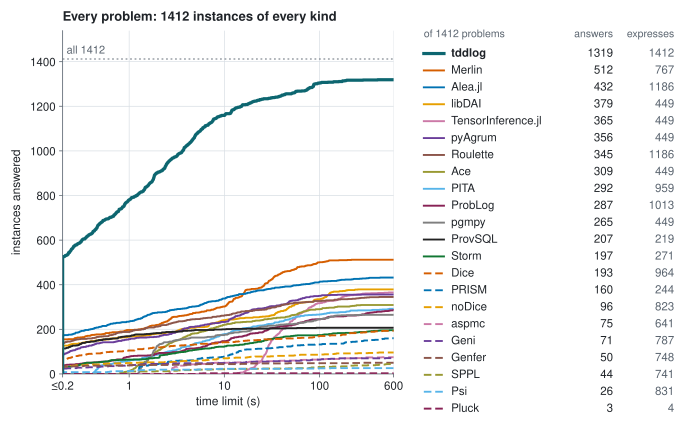
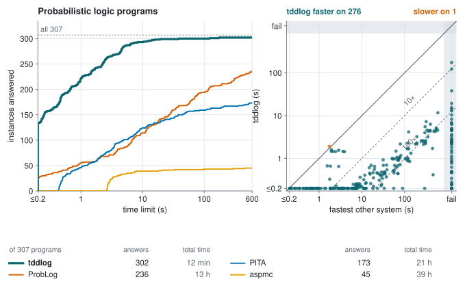
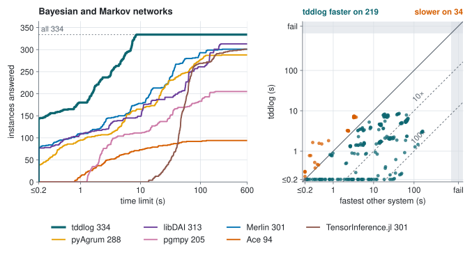
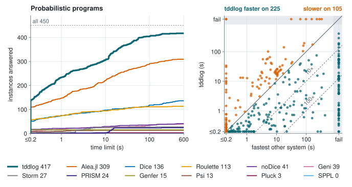
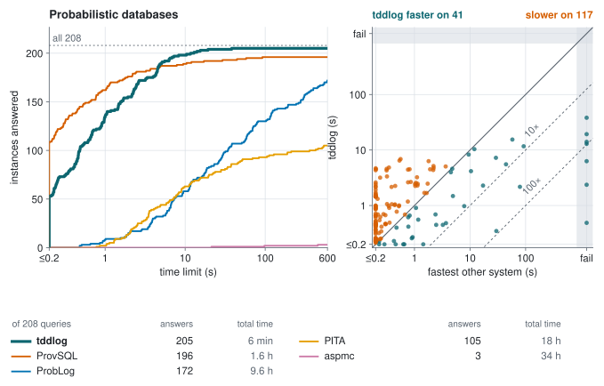

# tddlog

<p align="center">
  <a href="https://tractables.github.io/tddlog/"></a>
  <a href="https://tractables.github.io/tddlog/guide/"></a>
  <a href="https://pypi.org/project/tddlog/"></a>
  <a href="https://github.com/Tractables/tddlog/releases/latest"></a>
  <a href="https://github.com/Tractables/tddlog/actions/workflows/ci.yml"></a>
  <a href="https://tractables.github.io/tddlog/api/tddlog/"></a>
</p>

**Exact probabilistic inference by compilation into tree decision diagrams.**

tddlog computes exact probabilities for probabilistic logic programs
written in ProbLog, for Bayesian and Markov networks, and for the
discrete programs that probabilistic programming languages compile to.
It grounds a program, compiles it bottom up into tree decision diagrams
(TDDs) with the [tididi](https://github.com/Tractables/tididi) library,
and reads every query's probability off the diagrams. It is a Rust
library and command-line tool, with Python, C and WebAssembly bindings,
and it [runs in the browser](https://tractables.github.io/tddlog/).

<p align="center">
  
</p>

## Getting started

Install the command-line tool with Cargo, or the Python package with pip:

```sh
cargo install --git https://github.com/Tractables/tddlog tddlog
pip install tddlog
```

A program states probabilistic facts, rules, evidence and queries.
This is `examples/alarm.pl`:

```prolog
0.1::burglary.
0.2::earthquake.
0.7::hears_alarm(john).
0.4::hears_alarm(mary).
alarm :- burglary.
alarm :- earthquake.
calls(X) :- alarm, hears_alarm(X).
evidence(calls(john), true).
query(burglary).
query(earthquake).
query(calls(mary)).
```

tddlog prints the probability of each query given the evidence:

```text
$ tddlog examples/alarm.pl
burglary:       0.357143
earthquake:     0.714286
calls(mary):    0.400000
```

The [guide](https://tractables.github.io/tddlog/guide/) walks through the
language and the options with worked examples, and the
[playground](https://tractables.github.io/tddlog/) runs them in the browser.

## Performance

tddlog was run against every exact inference system that accepts each
benchmark suite, and every system tries every instance it can be given.
Each run is single-threaded on a core of its own, with a limit of 300 or
600 seconds, and every answer is checked against an exact reference.
Systems are compared by total time: each system's times summed over the
instances it is given and either system answers, a run that does not
finish counting as the time limit (its real time would be longer).

The cactus plots count the instances each system answers within a time
limit (higher is better). A large one draws every system over all the
instances of a kind, or of every kind as below: an instance a system
cannot express (its translator refuses the program) or was not given
counts as unanswered, and the legend gives how many instances each
system answers and how many it expresses (was given and did not
refuse). Under it, a small plot for
each cluster of systems with similar expressive capabilities (the
instances they express nearly the same: a Jaccard index of 0.9 or more)
covers the instances all of them express, with every system that
expresses all of those. The scatter plots put tddlog's time against
the fastest other system's on each instance (below the diagonal, tddlog
is faster). Every instance and time is on the
[results page](https://tractables.github.io/tddlog/results/), and every
program has a [page of its own](https://tractables.github.io/tddlog/results/benchmarks/)
that shows it as its authors wrote it and as each system was given it,
so that the translations can be checked for fairness.

<p align="center">
  
</p>

### Probabilistic logic programs: ProbLog, PITA and aspmc

<p align="center">
  
</p>

- **68× faster than ProbLog** in total: 12 minutes for the 302 programs,
  against ProbLog's 13 hours. On the 236 that ProbLog answers, tddlog
  takes 3 minutes and ProbLog 4.2 hours. ProbLog's time is the fastest
  of its three compilers (d-DNNF, SDD and forward SDD) on each program.
- **110× faster than PITA** and **211× faster than aspmc** in total;
  they answer 173 and 30 of the programs.
- tddlog answers 302 of the 307 programs and ProbLog 236. No system
  answers the other five.

The programs: random graphs and grids, smokers, UW-CSE, Cora, Biomine's
graphs, six families from published evaluations (pedigree,
mastermind, mnist_sum and others), the TPC-H queries and more.

### Bayesian and Markov networks: Ace, Merlin and the network libraries

<p align="center">
  
</p>

- tddlog answers **600 of the 652 networks**, in 62 minutes in total.
  The 52 it does not answer are partition functions of the UAI 2022
  final set (19 run out of time, 33 out of memory), and Merlin answers
  one of them. Merlin answers 444 of the 652.
- **15× faster than Merlin** (bucket-tree elimination) in total: 1.1
  hours over the 601 networks either answers, against Merlin's 17 hours.
  On the 443 both answer, 17 minutes against 2.3 hours.
- **35× faster than Ace** (compilation to arithmetic circuits) on the 94
  Bayesian networks it was run on, and 39× to 86× faster than pyAgrum,
  libDAI, TensorInference.jl and pgmpy on the 334 they were run on.
- Against the fastest other tool on each network, tddlog is 11× faster
  in total: 1.1 hours against 12 hours.

The networks: the bnlearn repository's, Ace's benchmarks, the large
networks (barley, diabetes, mildew, munin) and the UAI 2022
competition's sets: the MAR tuning set, for marginals and for the
probability of the evidence, and the PR tuning and final sets, for the
partition function. Ace ran on the 94 Bayesian networks of the first
three, ProbLog, PITA and aspmc on the 34 of the first, the network
libraries on all but the two PR sets, and Merlin on all 652.

### Probabilistic programs: Dice, Alea.jl, Roulette and others

<p align="center">
  
</p>

- tddlog answers 417 of the 450 programs and Alea.jl 309. Dice answers
  136 of the 228 it was given, where tddlog answers 218, and Roulette
  113 of its 196, where tddlog answers 189.
- **8.3× faster than Alea.jl**, **29× faster than Dice** and **46× faster
  than Roulette** in total. Alea.jl's and Roulette's times leave out
  their language's start-up and compilation.
- In total 58× faster than noDice, 24× than Psi, 5.8× than PRISM, 5.1×
  than Geni and 3.7× than Storm, each on the programs it is given. Storm
  is faster on the 27 programs both answer (4 minutes to tddlog's 6) and
  does not finish the other two.
- Specialized solvers win on their own programs: Genfer's generating
  functions answer its 15 (the population model and the Dice programs it
  ships) in 0.2 s in total, where tddlog takes 2 minutes; Pluck answers
  three of its four sequence models in 16 s, where tddlog takes 100 s;
  and Psi solves the linear regression symbolically, which tddlog does
  not finish.

The programs come from the papers on Dice, Alea.jl's bit blasting,
Roulette and Geni, and from the evaluations of the other systems, each
grown to sizes where the systems run out of time. tddlog runs them
translated to ProbLog and, for the bit-blasted programs, the Boolean
circuit Alea.jl builds.

### Probabilistic databases: ProvSQL

<p align="center">
  
</p>

The TPC-H queries over a tuple-independent database, at scale factors
0.001 to 0.1:

- **ProvSQL is fast on the easy queries.** It computes the probability
  inside PostgreSQL and answers 176 queries within 2 seconds, where
  tddlog answers 155.
- **tddlog answers more of the hard ones.** It answers 205 of the 208,
  9 of them queries ProvSQL does not finish, and it is faster on every
  query that takes ProvSQL 5 seconds or more. ProvSQL answers 196, none
  that tddlog misses.
- On the 196 queries both answer, tddlog takes 4.5 minutes in total and
  ProvSQL 6.1. With ProvSQL's 9 unfinished queries counted at the time
  limit, it is 6 minutes against 1.6 hours.

### Setup

The release run, tddlog 0.1.0 against ProbLog 2.3.0, PITA, aspmc, Ace
3.0, Merlin 1.7.0, pyAgrum 3.2.1, pgmpy 1.1.2, libDAI 0.3.2,
TensorInference.jl 0.6.3, ProvSQL 1.13.0, Dice, Alea.jl, Roulette and
the further systems, on lab and cloud machines. A suite's systems ran in
the same job, side by side in parallel lanes, so times compare within a
suite. The references are ProbLog, Ace, Merlin and Alea.jl where they
answer, Ganak's exact model count, and exact solvers written for this
repository. [docs/benchmarks.md](https://github.com/Tractables/tddlog/blob/baselines/docs/benchmarks.md) on the `baselines` branch has the machines,
versions and every table; the
[`baselines` branch](https://github.com/Tractables/tddlog/tree/baselines)
has the code that runs each system and the copies of their programs.

## Using tddlog

**The language** is the Datalog fragment of ProbLog: probabilistic facts
and rules, annotated disjunctions, negation as failure (also through
recursion), comparisons and integer arithmetic, `query/1` and
`evidence/1,2`. Function symbols, lists, cut and `findall` are not
supported.

**The command line** is `tddlog [options] program.pl`.
`--evidence-probability` also prints the probability of the evidence,
`--ground` prints the relevant ground program, `--stats` reports the
compilation, and `--vtree` chooses how the diagrams order the program's
variables (the default, `auto`, tries several layouts under growing
budgets). `tddlog --help` lists every option.

**Bayesian and Markov networks** in the BIF, Hugin, GeNIe and UAI formats
become programs through `scripts/gen_bn.py`; the answers are the
marginals given the evidence:

```
python3 scripts/gen_bn.py tests/regress/markov.uai --evid tests/regress/markov.uai.evid > markov.pl
./target/release/tddlog markov.pl
x0(v_0):        0.181818
x0(v_1):        0.818182
x1(v_0):        0.151515
x1(v_1):        0.848485
```

**As a library**, `tddlog::solve` takes a program's text and the command
line's options:

```rust
let options = tddlog::Options { evidence_probability: true, ..tddlog::Options::default() };
let solution = tddlog::solve(program, &options, &mut |_| {})?;
for answer in solution.answers.as_deref().unwrap_or_default() {
    println!("{answer}: {}", answer.probability);
}
```

The same call is wrapped for [Python](bindings/python/README.md)
(`tddlog.solve(program).answers`), [C](bindings/c/README.md) and
[WebAssembly](bindings/wasm/README.md). The
[API documentation](https://tractables.github.io/tddlog/api/tddlog/)
covers the rest.

## How it works

tddlog grounds the part of the program the queries and evidence depend
on, simplifies it as an and-inverter graph, and compiles each derived
atom into a TDD, one strongly connected component at a time, by
Tp-compilation (Vlasselaer et al., IJCAI 2015; Bogaerts and Van den
Broeck, ICLP 2015, for negation through recursion). The layout of the
diagrams' variables, their vtree, comes from tree decompositions of the
program computed with [goatd](https://github.com/Tractables/goatd). The
evidence is conjoined bottom up along the vtree and each query is
counted against it. [docs/design.md](docs/design.md) describes each
stage.

## Building from source

tddlog needs Rust 1.88 or newer and a C++ compiler (gcc 12 or newer, or a
recent clang) for goatd's vendored solver:

```
git clone https://github.com/Tractables/tddlog
cd tddlog
cargo build --release
./target/release/tddlog examples/alarm.pl
burglary:       0.357143
earthquake:     0.714286
calls(mary):    0.400000
```

`cargo test` checks tddlog against ProbLog's answers on its examples and
on ProbLog's own system tests. [CONTRIBUTING.md](CONTRIBUTING.md) lists
the checks a change runs.

## Citing

tddlog has no accompanying paper yet, so cite the software:

```bibtex
@misc{tddlog,
  author       = {Van den Broeck, Guy},
  title        = {tddlog: Exact Probabilistic Inference by Compilation into Tree Decision Diagrams},
  year         = {2026},
  howpublished = {\url{https://github.com/Tractables/tddlog}},
  note         = {Rust library and command-line tool, version 0.1.0}
}
```

## License

Apache-2.0 ([LICENSE](LICENSE)). The copies of third-party programs and
data in `tests/problog` and `data/` keep their own licenses
([NOTICE](NOTICE)); the components compiled into the binaries are listed
in [THIRD-PARTY.md](THIRD-PARTY.md).
