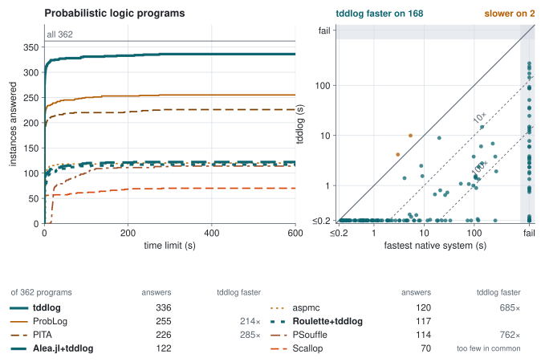
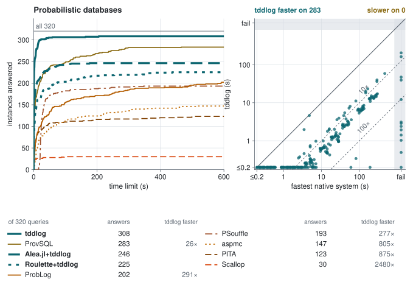
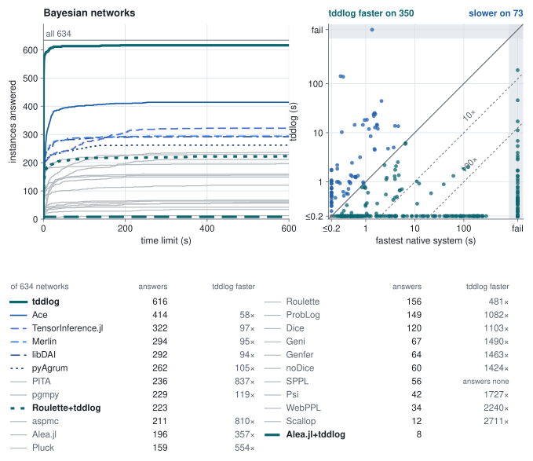
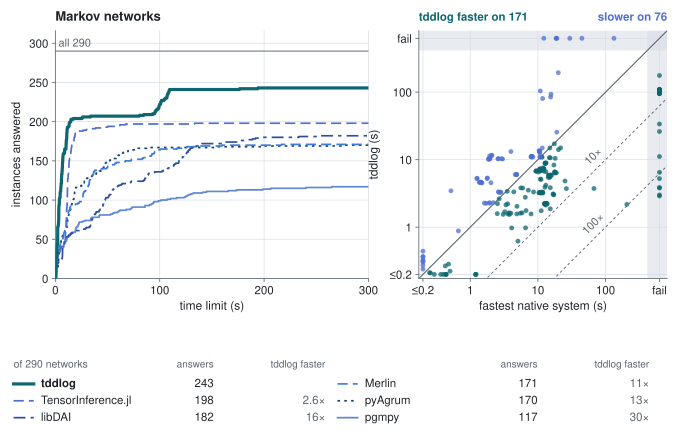
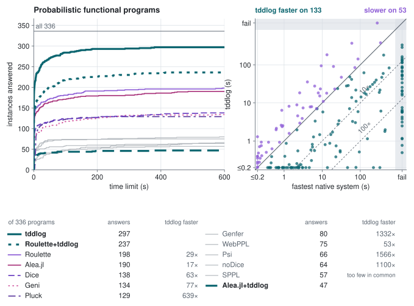
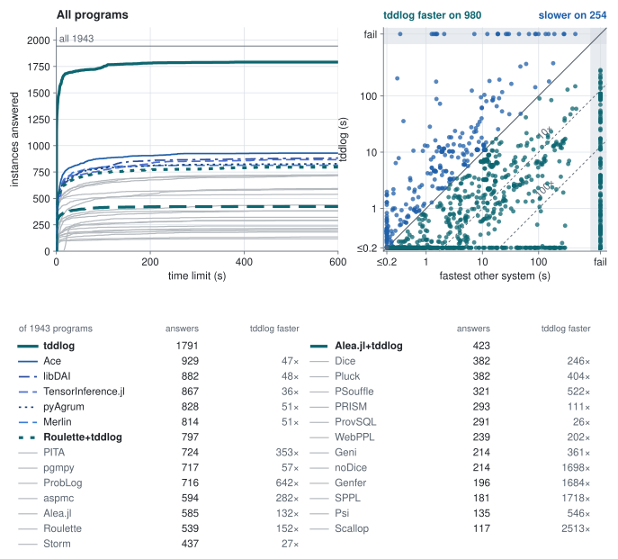
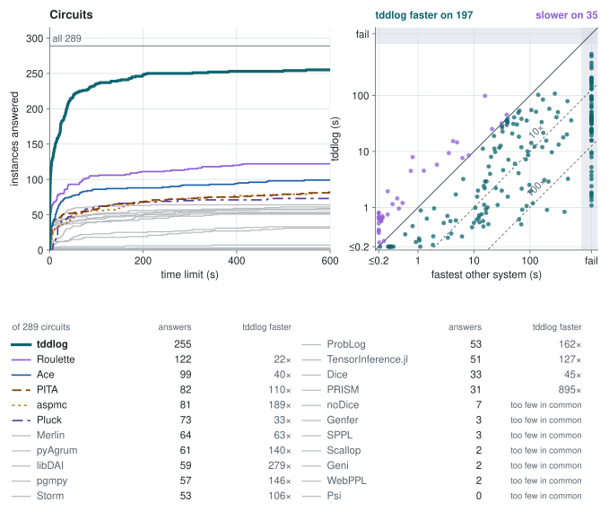

# tddlog

<p align="center">
  
  <br>
  <a href="https://github.com/Tractables/tddlog/actions/workflows/ci.yml"></a>
  <a href="https://tractables.github.io/tddlog/playground/"></a>
  <a href="https://tractables.github.io/tddlog/guide/"></a>
  <a href="https://tractables.github.io/tddlog/api/tddlog/"></a>
  <a href="https://tractables.github.io/tddlog/python/"></a>
  <a href="https://tractables.github.io/tddlog/c/"></a>
  <a href="https://tractables.github.io/tddlog/results/"></a>
</p>

**Exact probabilistic inference by compilation into tree decision diagrams.**

tddlog answers probabilistic Datalog programs exactly: probabilistic
facts, annotated disjunctions, and recursive rules with negation,
comparisons and arithmetic. [Front ends](#front-ends) reduce ProbLog
programs with function symbols and lists, Bayesian and Markov networks,
Dice programs, Circulette netlists and LPADs to it. tddlog grounds the
program, simplifies it, compiles it bottom up into tree decision diagrams
(TDDs) with the [tididi](https://github.com/Tractables/tididi) library, and reads every
query's probability off the diagrams. It is a Rust library and
command-line tool with Python, C and WebAssembly bindings, and it
[runs in the browser](https://tractables.github.io/tddlog/playground/).

<p align="center">
  
</p>

<!-- results:overview -->
<sub>Results as of 2026-11-05, public main [68b35beee](https://github.com/Tractables/tddlog/commit/68b35beee). Each row: a native system's answers of the type's instances, its total time (its colour) and tddlog's (teal) over the instances it is given and either answers, and how many times faster tddlog is ([how it is counted](#performance)).</sub>
<!-- /results:overview -->

On every type of program, tddlog answers more instances than each
exact inference system native to it, in less total time
([Performance](#performance)).

## Install

- **Command line:** `cargo install --locked --git https://github.com/Tractables/tddlog tddlog`.
- **Rust:** `tddlog = { git = "https://github.com/Tractables/tddlog" }` under
  `[dependencies]`. See the [Rust API].
- **Python:** build the package from a checkout. See the
  [Python README](bindings/python/README.md).
- **C and C++:** build the CMake package from a checkout. See the
  [C README](bindings/c/README.md).
- **Browser:** the [playground] runs tddlog in the tab, with nothing to install.

A build from source needs Rust 1.88 or newer and a C++ compiler (gcc 12
or newer, or a recent clang) for the tree-decomposition solver that goatd
vendors.

## Getting started

A program states probabilistic facts, rules, evidence and queries.
This is `examples/alarm.pl`:

```prolog
0.1::burglary.
0.2::earthquake.
0.7::hears_alarm(john).
0.4::hears_alarm(mary).
alarm :- burglary.
alarm :- earthquake.
calls(X) :- alarm, hears_alarm(X).
evidence(calls(john), true).
query(burglary).
query(earthquake).
query(calls(mary)).
```

tddlog prints the probability of each query given the evidence:

```text
$ tddlog examples/alarm.pl
burglary:       0.357143
earthquake:     0.714286
calls(mary):    0.400000
```

Each probabilistic fact `p::f` holds with probability p, independently
of the others, and the rules derive the other atoms. The alarm goes off
with probability 1 − 0.9 × 0.8 = 0.28, so John calls with probability
0.28 × 0.7 = 0.196, and P(burglary | John calls) = 0.1 × 0.7 / 0.196 =
0.357143.

A program can take values from the command line: the arguments after its
file take its places `$1`, `$2`, ... (outside comments and quoted
atoms), each read as a term, so that one program serves every size,
probability, query and observation. In
[examples/chain.pl](examples/chain.pl) they are the length of a chain,
the probability of each link and the node queried, and `--program`
prints the program with them in place:

```text
$ tddlog examples/chain.pl 10 0.9 4
reach(4):       0.656100
$ tddlog --program examples/chain.pl 20 0.9 7 > chain_20.pl
```

The [guide] describes the language and the command line, with worked
examples that open in the [playground].
[examples/](examples/) lists every example program by what it shows.

## Front ends

Every input is reduced to a probabilistic Datalog program before
inference:

| Input | Read by | Reduced to probabilistic Datalog as |
|---|---|---|
| ProbLog programs | tddlog | function symbols and lists ground to constants, with ProbLog's list predicates, `call/N`, `findall/3`, `all/3` and `forall/2` over probabilistic goals, and `library(aggregate)`'s aggregates |
| Bayesian networks in BIF, Hugin, GeNIe or UAI, with evidence in Ace's `.inst` or UAI's `.evid` | tddlog, by the file's extension | one annotated disjunction per row of each table |
| Markov networks in UAI | tddlog | one observed atom per factor; `--evidence-probability` prints the partition function |
| Dice programs | tddlog, by the extension `.dice` | each integer as its bits, each operation as rules over them, a loop as recursion over a step index |
| Circulette netlists | tddlog, by the extension `.cql` | the netlist as facts, one rule per kind of gate over its operands' bits, a fault on each logic gate the outputs read, the failure as evidence; every single, pair and triple of faults a query |
| Alea.jl programs | Alea.jl's tddlog backend, on the branch [`tddlog` of Tractables/Alea.jl](https://github.com/Tractables/Alea.jl/tree/tddlog): `pr(x; algo = Tddlog())` runs tddlog on the circuit, `write_problog(io, x)` writes it | the Boolean circuit Alea.jl builds: each flip a probabilistic fact, each gate a rule, each observation evidence; Alea.jl+tddlog in the results |
| Roulette programs | Roulette's tddlog engine, on the branch [`tddlog` of Tractables/roulette](https://github.com/Tractables/roulette/tree/tddlog), a fork of neuppl/roulette: `racket -l- roulette/engine/tddlog PROGRAM.rkt` writes the circuit, and with `--tddlog` the program runs with tddlog answering its queries | the Boolean circuit Roulette builds: each flip a probabilistic fact, each gate a rule, each observation evidence; Roulette+tddlog in the results |
| LPADs written for cplint and PITA | tddlog, where the file holds `:- begin_lpad.` | the same clauses in ProbLog's syntax, with the database clauses they call and the file's example queries; under PITA's depth bound, each predicate with the depth as an argument; PRISM's switches as annotated disjunctions of `msw/2` |

```text
$ tddlog examples/car.net --evidence examples/car.inst --query fuel,plugs,starter
$ tddlog tests/dice/arith.dice
$ tddlog --program tests/lpad/coin.cplint.pl
```

`--program` prints the program an input is read as, and `--ground` the
ground program after it, which ProbLog also reads, so each reduction can
be checked on its own. `--cnf` writes that ground program as a weighted CNF
for a weighted model counter. On the UAI networks measured, the counters
took 12 to 261 times as long as tddlog, since they read clauses where
tddlog compiles tables ([why](docs/design.md#grounding-srcground)). As a
library, [`tddlog::read`] reads an input in
any of these formats as a program and [`tddlog::solve`] answers it; the
[Python](bindings/python/README.md) (`tddlog.solve(text, format="dice")`),
[C](bindings/c/README.md) and [WebAssembly](bindings/wasm/README.md)
bindings take the text with its format's name. A front end of one's own
writes the program's text, as [examples/sprinkler.rs](examples/sprinkler.rs)
does from Rust data.

Not yet read: cut, if-then-else, `assert`, strings and a findall in a
cycle of calls in ProbLog; `/`, `%` and `sample` in Dice.

## Inside the engine

[docs/design.md](docs/design.md) describes each stage and the cases
measured behind it.

**Grounding and simplification**

- **Relevant grounding.** Magic sets and semi-naive evaluation ground
  only what the queries and the evidence depend on, ProbLog's relevant
  ground program (Fierens et al., TPLP 2015). Transitive closures ground
  from their bound end, and linear recursion is solved without iteration
  by Gaussian elimination (Tarjan, 1981).
- **And-inverter graph.** Acyclic rules are hashed into an and-inverter
  graph, so a gate the program writes many times is built once (of a
  12-bit circuit's 6 635 gates, 4 941 merge). Gates equal to another
  gate, to its negation or to a constant are found by random simulation,
  proved by SAT and merged (fraiging, Mishchenko et al., 2005).
- **Conditioning.** Unit propagation, SAT backbones and equivalences fix
  and merge facts under the evidence, and tables are renormalized to it.
- **Table structure.** The rows of one distribution share a class atom,
  rows that exclude each other share switches, and a choice read under
  exclusive contexts becomes one fact per context.

**Compilation**

- **Tp-compilation.** Each derived atom's TDD is built bottom up by the
  immediate-consequence operator on diagrams (Vlasselaer et al., IJCAI
  2015), one strongly connected component at a time, each shared atom
  once, and each component over the part of the vtree its facts lie in.
  Negation through recursion takes the well-founded fixpoint by
  approximation fixpoint theory (Bogaerts and Van den Broeck, ICLP 2015),
  which answers sound programs that ProbLog rejects.
- **Names where depth needs them.** An atom read across a narrow cut of
  the variable order is read through a named copy tied to its
  definition, as in a Tseitin encoding. After the compile, each name is
  kept or composed away, whichever gives the smaller diagram.

**Vtrees**

- **Layouts from the program.** A vtree, the layout of the diagrams'
  variables, is read from tree decompositions computed with
  [goatd](https://github.com/Tractables/goatd), from the rules'
  dependency order, from the order the program states its facts in, or
  from its rules' fan-in. In a bit-blasted program, an atom read under a
  fact is read conditioned on it, a decision list becomes a balanced
  tree, and these guards give the vtree.
- **Layouts as trials.** By default, several layouts run in turns under
  doubling budgets of engine work, one of them a vtree searched by
  rotations during the compile, and the first to finish answers. The
  budgets count pairs and units of work, not seconds, so the same layout
  wins on every machine.

**Queries and evidence**

- **Every marginal in one pass.** The evidence is conjoined bottom up
  along the vtree, and every query is read off one backward pass.
  Probabilities below a double's range keep an exponent of their own
  instead of underflowing.
- **Summing out.** Where only the probability of the evidence or a
  partition function is asked, each join sums out what no later join
  reads.

## Performance

tddlog was compared with every exact inference system we could find, on
five types of program, each against the systems that natively handle it,
and on [all programs](#all-programs) together, against every system.
Where another system's code runs first and hands the inference to tddlog,
the [integrations](#integrations) compare the two.
Every answer is checked against an exact reference. Each table gives a
system's answers, its total time and tddlog's over the instances it is
given as its users would write them and either answers, and how many
times faster tddlog is. The
[results page](https://tractables.github.io/tddlog/results/) has every
instance, time and program, and a page for each system.

<!-- results:setup -->
<!-- written from bindings/wasm/results/categories.json, sha256 2beaeb1d2805b1aaf9899e465008c3846ae08d8c658395ace2bcc33ee74caac8 -->
Results as of 2026-11-05, public main [68b35beee](https://github.com/Tractables/tddlog/commit/68b35beee). Runs are single-threaded, under a time limit of 300 or 600 s by suite; a run that does not answer counts as twice its limit, and a time under 0.2 s as 0.2 s.
<!-- /results:setup -->

The results page says how the speed-up is counted, and the
[`baselines` branch](https://github.com/Tractables/tddlog/tree/baselines)
how each system was run.

### Probabilistic logic programs

<p align="center">
  
</p>

<!-- results:logic-programs -->
tddlog answers **336 of 362** programs, of 25 families.
<!-- /results:logic-programs -->

The ProbLog programs: paths in random graphs and grids, Biomine's paths,
smokers, UW-CSE, Cora's citation matching, blood types and pedigrees,
sickness, Mastermind, MNIST addition and handwritten formulas, Prob-EC's
event calculus, taint analyses of Android apps, probabilistic grammars,
hidden Markov models, and the programs of the ProbLog tutorial and of
ProbLog's and cplint's examples.

<!-- results:logic-programs-table -->
| System | Answers | Its total time | tddlog's total time | tddlog faster |
|---|--:|--:|--:|--:|
| ProbLog | 255 | 15 h | 28 min | 156× |
| PITA | 226 | 20 h | 28 min | 187× |
| aspmc | 120 | 38 h | 28 min | 279× |
| PSouffle | 112 | 41 h | 28 min | 694× |
| Scallop | 67 | 47 h | 28 min | too few in common |
<!-- /results:logic-programs-table -->

- On Biomine, ProbLog's own benchmark, tddlog answers all 10 queries and
  ProbLog 4.

### Probabilistic databases

<p align="center">
  
</p>

<!-- results:database-queries -->
tddlog answers **308 of 320** queries, of 19 families.
<!-- /results:database-queries -->

The queries are Boolean queries over tuple-independent databases: 16
TPC-H queries, the queries h0 and h1, the safe queries QW and Q9, and
paths of two edges in random graphs.

<!-- results:database-queries-table -->
| System | Answers | Its total time | tddlog's total time | tddlog faster |
|---|--:|--:|--:|--:|
| ProvSQL | 283 | 9.3 h | 20 min | 25× |
| ProbLog | 202 | 39 h | 20 min | 273× |
| PSouffle | 193 | 40 h | 20 min | 206× |
| aspmc | 147 | 56 h | 20 min | 689× |
| PITA | 123 | 62 h | 20 min | 522× |
| Scallop | 30 | 90 h | 20 min | 470× |
<!-- /results:database-queries-table -->

- Where others win: ProbLog on the paths of two edges in random graphs
  of 14 and 17 nodes, in 4.8 s and 39 s against tddlog's 18 s and 182 s.

### Bayesian networks

<p align="center">
  
</p>

<!-- results:bayesian-networks -->
tddlog answers **607 of 634** networks, of 12 families.
<!-- /results:bayesian-networks -->

The networks: bnlearn's, the large ones and the Roulette and noDice
papers' versions among them, Ace's, the noisy-or networks, and the
networks of the UAI 2022 competition and of Ihler's collection whose
factors are conditional probability tables (diagnosis, pedigree, BN,
blockmap, Mastermind and fs networks, and the classic networks).

<!-- results:bayesian-networks-table -->
| System | Answers | Its total time | tddlog's total time | tddlog faster |
|---|--:|--:|--:|--:|
| Ace | 414 | 34 h | 1.3 h | 23× |
| TensorInference.jl | 321 | 56 h | 1.5 h | 34× |
| Merlin | 292 | 57 h | 1.5 h | 34× |
| libDAI | 290 | 58 h | 1.5 h | 33× |
| pyAgrum | 261 | 63 h | 1.5 h | 37× |
| 15 others: PITA, pgmpy, aspmc, Alea.jl, Roulette, Pluck, ProbLog, Dice, Genfer, SPPL, noDice, Psi, Geni, WebPPL, Scallop | 12 to 236 | over 19 h each | 2 min to 1.5 h | at least 42× |

PSouffle was given 11 of the networks and answers 6.
<!-- /results:bayesian-networks-table -->

- Where others win: the networks named BN of Ihler's collection. tddlog
  runs out of time on seven that pyAgrum or Merlin answers in 0.3 to 2.1 s,
  and on 20 more Merlin, pyAgrum or TensorInference.jl is at least twice
  as fast, up to 0.3 s against tddlog's 204 s.

### Markov networks

<p align="center">
  
</p>

<!-- results:markov-networks -->
tddlog answers **243 of 290** networks, of 11 families.
<!-- /results:markov-networks -->

The networks are those of the UAI 2022 competition and of Ihler's
collection whose factors are not conditional probability tables over an
acyclic graph: object detection, segmentation, grid, DBN, CSP and
Alchemy networks, protein side chains, the rus networks, weighted CSPs,
and pedigree and diagnosis networks.

<!-- results:markov-networks-table -->
| System | Answers | Its total time | tddlog's total time | tddlog faster |
|---|--:|--:|--:|--:|
| TensorInference.jl | 198 | 9.3 h | 2.5 h | 2.6× |
| libDAI | 180 | 13 h | 1.4 h | 16× |
| Merlin | 171 | 13 h | 1.5 h | 11× |
| pyAgrum | 170 | 13 h | 1.4 h | 13× |
| pgmpy | 117 | 22 h | 1.4 h | 28× |
<!-- /results:markov-networks-table -->

- Where others win: six partition functions of the UAI 2022 final set,
  five of them protein networks, and Ihler's pedigree50 run out of time
  or memory. TensorInference.jl answers the six in 12 to 45 s and
  pedigree50 in 133 s.

### Probabilistic functional programs

<p align="center">
  
</p>

<!-- results:functional-programs -->
tddlog answers **297 of 335** programs, of 25 families.
<!-- /results:functional-programs -->

The programs are over discrete values with conditionals and loops: the
Caesar cipher, diamond and ladder networks, Geni's router grids with
failing links or routers and its weather factory, hidden Markov models
and Pluck's sequence models, a Markov chain, a lossy network, contract
signing, a perturbed-memory interpreter, Cao et al.'s integer programs,
the coupon collector, 3-SAT, the bounded retransmission protocol,
Circulette's netlists and the Dice paper's small programs. tddlog counts
as unanswered on the programs only another system's front end reads:
Alea.jl's on Cao et al.'s integer programs and Pluck's sequence models,
whose integration Alea.jl+tddlog is [below](#integrations) and whose
circuits are [below](#circuits) too.

<!-- results:functional-programs-table -->
| System | Answers | Its total time | tddlog's total time | tddlog faster |
|---|--:|--:|--:|--:|
| Roulette | 195 | 35 h | 1.3 h | 19× |
| Alea.jl | 191 | 24 h | 1.2 h | 13× |
| Dice | 137 | 42 h | 1.2 h | 44× |
| Pluck | 123 | 46 h | 1.2 h | 34× |
| Genfer | 83 | 59 h | 1.2 h | 428× |
| 5 others: Geni, noDice, SPPL, WebPPL, Psi | 19 to 78 | over 57 h each | 1.2 h to 1.4 h | at least 24× |
<!-- /results:functional-programs-table -->

### All programs

<p align="center">
  
</p>

<!-- results:all-programs -->
tddlog answers **1791 of 1941** programs.
<!-- /results:all-programs -->

All programs are the five types together, every system on every program
it is given, natively or through a translation.

<!-- results:all-programs-table -->
| System | Answers | Its total time | tddlog's total time | tddlog faster |
|---|--:|--:|--:|--:|
| Ace | 955 | 146 h | 4.7 h | 38× |
| libDAI | 878 | 169 h | 5.0 h | 43× |
| TensorInference.jl | 867 | 182 h | 6.0 h | 33× |
| pyAgrum | 827 | 177 h | 5.0 h | 43× |
| Merlin | 810 | 186 h | 5.2 h | 39× |
| 19 others: PITA, ProbLog, pgmpy, aspmc, Alea.jl, Roulette, Pluck, Storm, Dice, PSouffle, ProvSQL, PRISM, noDice, WebPPL, Genfer, Geni, SPPL, Psi, Scallop | 118 to 723 | over 9.6 h each | 21 min to 5.2 h | at least 25× |
<!-- /results:all-programs-table -->

- Where others win: pgmpy answers grid25, a logic program's path query
  across a 25 by 25 grid of probabilistic edges, in 144 s on the
  program's ground network, and tddlog runs out of time. PRISM and Storm
  answer Geni's four largest router networks (PRISM alone the largest,
  48 routers), which tddlog does not, by
  value iteration over decision diagrams in double precision; their
  exact engines time out from 18 to 20 routers.

### Circuits

<p align="center">
  
</p>

<!-- results:circuits -->
tddlog answers **255 of 289** circuits, of 33 families.
<!-- /results:circuits -->

The circuits are an evaluation of their own, apart from the five types:
each circuit Alea.jl exports of its programs, the bit-blasted arithmetic
and the integer programs and sequence models among the functional
programs. Every system reads the circuit, as it is or translated into
its language, and no one pays for its export.

<!-- results:circuits-table -->
| System | Answers | Its total time | tddlog's total time | tddlog faster |
|---|--:|--:|--:|--:|
| Roulette | 122 | 46 h | 2.3 h | 22× |
| Ace | 99 | 54 h | 2.3 h | 40× |
| PITA | 82 | 60 h | 2.3 h | 110× |
| aspmc | 81 | 60 h | 2.3 h | 189× |
| Pluck | 73 | 61 h | 2.2 h | 33× |
| 16 others: Merlin, pyAgrum, libDAI, pgmpy, Storm, ProbLog, TensorInference.jl, Dice, PRISM, noDice, Genfer, SPPL, Scallop, Geni, WebPPL, Psi | 0 to 64 | over 63 h each | 2.1 h to 2.3 h | at least 45× |
<!-- /results:circuits-table -->

### Integrations

X+tddlog runs X's own code, then tddlog's inference on what X exports,
against X alone, whose numbers are in brackets. The
[integrations' pages](https://tractables.github.io/tddlog/#/integrations)
have the programs and plots. Each integration lives in its system's own
code base, under that system's licence: Alea.jl+tddlog is Alea.jl's tddlog
backend, on the branch [`tddlog` of
Tractables/Alea.jl](https://github.com/Tractables/Alea.jl/tree/tddlog), and
Roulette+tddlog is Roulette's tddlog engine, on the branch [`tddlog` of
Tractables/roulette](https://github.com/Tractables/roulette/tree/tddlog), a
fork of neuppl/roulette.

<!-- results:integrations -->
| Integration | Instances | Answers | Total time | Faster |
|---|--:|--:|--:|--:|
| Alea.jl+tddlog against Alea.jl | 310 | 271 (Alea.jl 178) | 3.7 h (Alea.jl 35 h) | 6.7× |
| Roulette+tddlog against Roulette | 581 | 444 (Roulette 320) | 7.1 h (Roulette 38 h) | 4.0× |
<!-- /results:integrations -->

## Building and testing

From a checkout, `cargo build --release` builds `target/release/tddlog`,
and `cargo test` checks it against ProbLog's answers on the examples and
on ProbLog's own system tests. [CONTRIBUTING.md](.github/CONTRIBUTING.md) lists
the checks a change runs.

## Citing

tddlog has no paper yet: cite the software, as [CITATION.cff](CITATION.cff)
describes it (GitHub's "Cite this repository"). TDDs were introduced in
[*A Canonical Generalization of OBDD*](https://arxiv.org/abs/2604.05537).

## Acknowledgements

This material is based upon work supported by the Defense Advanced Research
Projects Agency (DARPA) under Agreement No. HR0011269E224.

## License

Apache-2.0 ([LICENSE](LICENSE)). The copies of third-party programs in
`tests/problog` and `tests/dice` keep their own licenses
([NOTICE](NOTICE)); [THIRD-PARTY.md](THIRD-PARTY.md) lists the components
compiled into the binaries.

[guide]: https://tractables.github.io/tddlog/guide/
[playground]: https://tractables.github.io/tddlog/playground/
[Rust API]: https://tractables.github.io/tddlog/api/tddlog/
[`tddlog::solve`]: https://tractables.github.io/tddlog/api/tddlog/fn.solve.html
[`tddlog::read`]: https://tractables.github.io/tddlog/api/tddlog/fn.read.html
