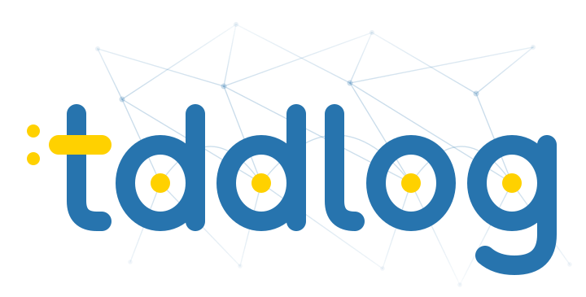

# tddlog for Python

<p align="center">
  
  <br>
  <a href="https://pypi.org/project/tddlog/"></a>
  <a href="https://github.com/Tractables/tddlog/actions/workflows/ci.yml"></a>
  <a href="https://tractables.github.io/tddlog/"></a>
  <a href="https://tractables.github.io/tddlog/python/"></a>
</p>

**Exact probabilistic inference from Python.**

tddlog computes exact probabilities for ProbLog programs, LPADs, Dice
programs, Circulette netlists and Bayesian and Markov networks. This
package calls the same Rust implementation as the
[command line](https://github.com/Tractables/tddlog).

## Install

```sh
pip install tddlog
```

Wheels cover CPython 3.10 and later on Linux and macOS (x86-64 and
ARM64) and Windows x86-64. Elsewhere pip builds from source
(Build from source, below).

## Getting started

```python
import tddlog

solution = tddlog.solve("""
    0.1::burglary.
    0.2::earthquake.
    0.7::hears_alarm(john).
    0.4::hears_alarm(mary).
    alarm :- burglary.
    alarm :- earthquake.
    calls(X) :- alarm, hears_alarm(X).
    evidence(calls(john), true).
    query(burglary).
    query(earthquake).
    query(calls(mary)).
""", evidence_probability=True)

for query, probability in solution.answers.items():
    print(f"{query}: {probability:.6f}")
print(f"P(e) = {solution.evidence_probability:.6f}")
```

prints

```text
burglary: 0.357143
earthquake: 0.714286
calls(mary): 0.400000
P(e) = 0.196000
```

- `solution.answers` maps each query to its probability given the
  evidence, in the program's order. It is `None` where the evidence is
  inconsistent.
- `format` says what the text is: `"problog"` (the default, LPADs
  included), `"dice"`, `"circulette"`, or a network's `"bif"`, `"hugin"`,
  `"xdsl"` or `"uai"`.
- `evidence` is the text of a network's evidence file (Ace's `.inst` or
  UAI's `.evid`).
- `arguments` is a list of strings that take the program's places `$1`,
  `$2`, ...
- `vtree`, `evidence_probability` and `queries` are the command line's
  `--vtree`, `--evidence-probability` and `--no-queries`.
- An error raises `tddlog.ParseError`, `GroundingError` or
  `CompilationError`, with the command line's message.
- `solve` releases the interpreter lock, so threads can solve several
  programs at once.

A network with evidence, in a checkout of the repository:

```python
network = open("examples/car.net").read()
observed = open("examples/car.inst").read()
solution = tddlog.solve(network, format="hugin", evidence=observed)
```

The [API reference](https://tractables.github.io/tddlog/python/reference.html)
documents each function and exception, and `bindings/python/examples/`
holds this program and one built from Python data. The
[guide](https://tractables.github.io/tddlog/guide/) describes the
language, and its worked examples open in the
[playground](https://tractables.github.io/tddlog/playground/). The
[website](https://tractables.github.io/tddlog/) has the benchmark results.

## Build from source

pip builds the package from the repository, for a commit after the
release. This needs Python 3.10 or later, Rust 1.88 or newer
([rustup](https://rustup.rs) installs it), a C++20 compiler and `make`.
The guide's
[getting started](https://tractables.github.io/tddlog/guide/#getting-started)
says what to do if the build fails.

```sh
python3 -m venv .venv
. .venv/bin/activate
python -m pip install "git+https://github.com/Tractables/tddlog#subdirectory=bindings/python"
```

From a checkout, copy the license and the notices in first:

```sh
git clone --depth 1 https://github.com/Tractables/tddlog
cd tddlog
mkdir -p bindings/python/notices
cp LICENSE NOTICE THIRD-PARTY.md bindings/python/notices/
python -m pip install ./bindings/python
```

To work on the binding, build the extension in place and run its tests:

```sh
python -m pip install 'maturin>=1.9,<2' pytest
maturin develop --release --manifest-path bindings/python/Cargo.toml
python -m pytest bindings/python/tests
```

## Acknowledgements

This material is based upon work supported by the Defense Advanced Research
Projects Agency (DARPA) under Agreement No. HR0011269E224.
